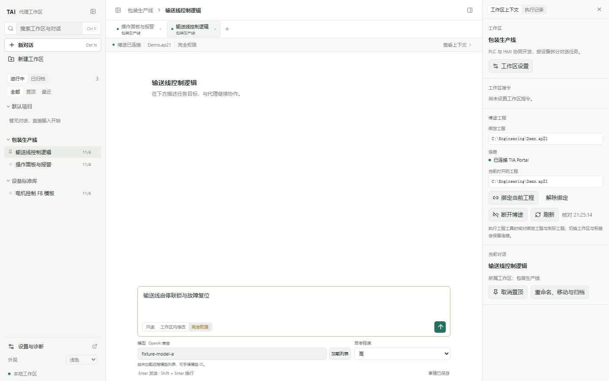
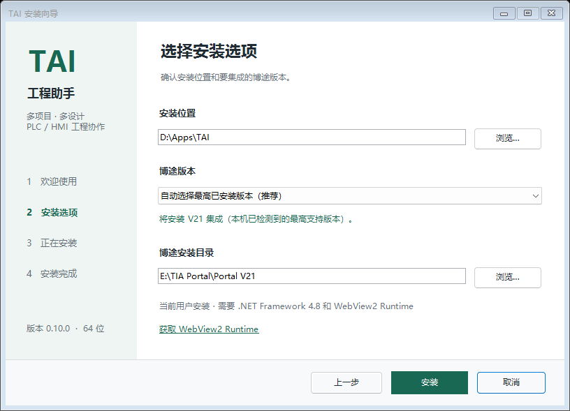

# TAI 工程助手

TAI 是 Windows 本地 TIA Portal V19 / V21 工程助手，提供多项目、多设计标签、工程上下文管理及 PLC / HMI 工具。

[下载安装包](https://github.com/joahpass/TAI/releases/latest) · [工作台说明](tai/WORKSPACE.md)



## 安装

从 Releases 下载安装 EXE。需要 Windows x64、.NET Framework 4.8、WebView2 Runtime 和匹配版本的 TIA Portal Openness。

向导包括欢迎、安装选项、安装进度和完成页面。默认选择本机已安装且具有匹配 Openness 组件的最高支持版本，V21 优先于 V19；也可手动指定。升级沿用原安装目录。安装前退出 TAI 托盘集成并关闭 TAI 窗口。

安装完成可直接启动工作台。模型接口在“设置”中配置；配置与会话默认保存在当前用户的 `%LOCALAPPDATA%\TAI`，卸载保留用户数据。



## 检查更新

工作台左下角“设置”提供“检查更新”。软件读取本仓库最新稳定 GitHub Release，与当前版本比较，提供发布页面链接。下载新版安装包后运行升级，不自动执行安装包。

开发部署可通过 `TAI_GITHUB_REPOSITORY=owner/repo` 覆盖更新仓库；默认由应用元数据指向 `joahpass/TAI`。网络错误可重试，结果会缓存。

## 源码运行

```bash
cd tai/frontend
npm ci
npm run build
cd ..
npm start
```

需要 Node.js 22 或更新。打开 `http://127.0.0.1:17821/workspace`。`/assistant` 为紧凑助手，`/settings` 与 `/` 为配置和诊断。

## 构建

保留 `tai/` 与 `mcp-v21/` 相邻布局。MCP 需要对应 Siemens Engineering SDK，这些 SDK 不随仓库和安装包分发。参见 [MCP 项目配置](mcp-v21/TiaMcpServer.csproj)。V21 后端还引用独立的 `PlcTutor.Engineering` 项目；其源码未纳入本仓库，默认查找相邻目录，也可构建时传入 `-p:PlcTutorEngineeringProject=<项目完整路径>`。使用现成安装包无需单独准备该项目。

```bash
cd tai/desktop
bash build-release.sh --online
```

参见 [桌面构建说明](tai/desktop/RELEASE.txt) 和 [V21 AddIn 构建脚本](tai/tia-addin/build.ps1)。准备好两版 MCP、AddIn、前端构建及 Node 后：

```powershell
pwsh -NoProfile -File tai/installer/Build.ps1 -DesktopDir <desktop-release-dir> -Version 0.10.0
```

产物输出至 `tai/dist`。

## 测试

前端运行 `npm --prefix tai/frontend test`。后端离线验证和浏览器用例参见 [工作台说明](tai/WORKSPACE.md)；更新检查测试为 `node --test tai/server/updates.test.mjs`。

[向导检查](tai/installer/Test-Wizard.ps1) 覆盖页面导航、最高版本选择、进度与失败重试。[隔离安装检查](tai/installer/Test-Installer-Offline.ps1) 使用临时目录及 SDK/验证器替身，覆盖安装、升级、版本切换和卸载。生产安装器保留真实组件预检；隔离检查不代表真实博途联调已完成。

本次发布验证采用离线测试。真实 TIA 测试脚本需确认对应工程和会话范围后执行。

## 通用版可行性

通用版采用一个安装包、统一版本资料与分代适配器。安装器、服务端和设置页共用版本 manifest，记录 SDK 布局、程序集身份、后端路径、工具能力与验证等级。自动选择顺序为：发现全部安装版本 → 匹配包内适配器与 SDK 契约 → 选择最高匹配版本；更高版本缺适配器时显示具体原因，并继续考虑较低匹配版本。

当前 0.10.0 的适配器为 V19 / V21。后续 V17、V18、V20 作为候选，不把版本号放开等同于支持。V19 反射桥适合抽为按版本参数化的旧版适配器，需同步参数化程序集身份、组件及工程扩展名；V21 使用拆分 SDK，保留独立映射。V20 需要先核对真实 SDK 布局，当前安装器与解析器对其目录代际的判断存在差异。

通用版将分别显示“检测到安装”“适配器已提供”“SDK 契约通过”“协议通过”“指定工具工程实测通过”。离线矩阵覆盖 17/18/19/20/21 与未知未来版本的共存、缺适配器、SDK 错配及自动回退；再逐版验证真实 SDK 和一次性工程。新版本以新增 profile 扩展，避免在各处维护两项版本数组。

